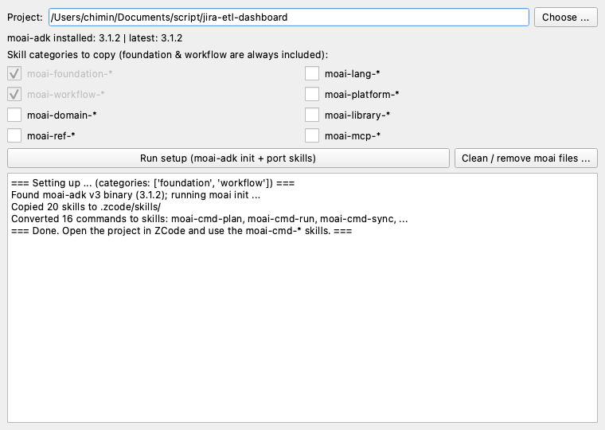
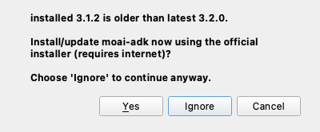
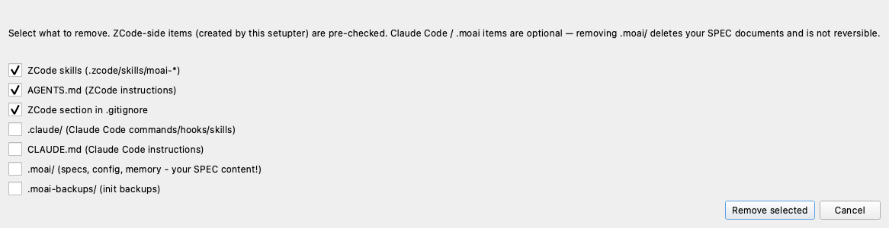

# MoAI-ADK → ZCode Setupter

A small PySide6 (Qt) desktop app that ports the
[MoAI-ADK](https://pypi.org/project/moai-adk/) SPEC-First TDD workflow
(EARS requirements, TRUST-5 quality gates, plan → run → sync) into any git
project so it can be used from **ZCode**, not just Claude Code.



## Why

MoAI-ADK integrates with Claude Code via `.claude/` commands, skills, hooks
and a `CLAUDE.md`. ZCode reads none of those — it uses `.zcode/skills/` and
`AGENTS.md`. This app bridges the two: pick a project folder, click once, and
the whole workflow becomes available in ZCode while Claude Code keeps working
unchanged in the same repo.

## What it does on the chosen project folder

Works with both generations of moai-adk:

- **v3.x (current, Go binary)** — runs `moai init --non-interactive --force`,
  then ports the project's `.claude/skills` (including the `moai` dispatcher
  skill with its plan/run/sync workflows) and converts all 17 `.claude/commands/moai/*`
  slash commands (`plan`, `run`, `sync`, `fix`, `loop`, `review`, `gate`,
  `feedback`, ...) into ZCode skills. `AGENTS.md` is derived from the
  project's `CLAUDE.md` if moai init didn't create one.
- **v0.x/1.x (legacy Python package)** — runs `moai-adk init -y --force` and
  ports templates from the uv site-packages path.
- **No installation** — falls back to a shallow clone of the moai-adk GitHub
  repo and does a read-only port (skills/commands only; you'll need to run
  `moai init` yourself later for the `.moai/` scaffolding).

In all cases, Claude-specific mechanics are rewritten for ZCode:

- `!cmd` pre-execution lines → "Run in the project shell" instructions
- `@file` includes → "Read this file first" instructions
- `$ARGUMENTS` → a described placeholder

A small ZCode section is appended to `.gitignore`: ported skills and
`AGENTS.md` are tracked (they are project workflow assets), while local state
and secret patterns under `.zcode/skills/` are ignored.

### Auto install/update of moai-adk

The app checks the installed moai-adk version against the latest GitHub
release. If it is missing or outdated, running setup offers to install or
update it via the official installer (curl script on macOS/Linux, PowerShell
on Windows) before continuing.



### Suspend / resume moai in Claude Code

moai-adk's rule files add ~250k chars of always-loaded instructions in Claude
Code. Before a context-size-demanding task, the **Suspend** button renames
`CLAUDE.md`, `AGENTS.md` and `.claude/rules/` to `*.off` so the next Claude
session starts light (hooks, commands and settings stay active). The same
button becomes **Resume** to rename them back. Only affects sessions started
after the change.

### Clean / uninstall



The **Clean** button removes exactly what the setupter added — only
`moai-*`-prefixed skills are deleted from `.zcode/skills/`, so your own
skills are never touched. Removing the Claude Code side (`.claude/`,
`CLAUDE.md`, `.moai/`) is opt-in via checkboxes; `.moai/` holds your SPEC
documents, so think twice before checking it.

## Install (macOS)

Download `MoAI-ZCode-Setupter-macos.zip` from the
[latest release](https://github.com/CJ-1981/moai-zcode-setupter/releases/latest),
unzip, and move `MoAI-ZCode-Setupter.app` to `/Applications`. The app is not
notarized, so on first launch right-click → Open (or System Settings →
Privacy & Security → "Open Anyway"). The MoAI-ADK CLI is still required
externally — see Requirements.

## Requirements

- macOS (tested on Apple Silicon) or Windows or Linux
- Python 3.12+ and [uv](https://docs.astral.sh/uv/) (to run from source)
- MoAI-ADK CLI — **optional**: the app detects the installed version and,
  if it is missing or outdated, offers to install/update it automatically
  using the official installer (curl script on macOS/Linux, PowerShell on
  Windows) before running the setup.

## Run from source

```bash
git clone https://github.com/CJ-1981/moai-zcode-setupter.git
cd moai-zcode-setupter
uv run python main.py
```

## Usage

1. Launch the app, choose the target git repo folder.
2. Tick the optional skill categories you want (language / domain / platform
   skills for your stack).
3. Click **Run setup**.
4. Open the project in ZCode and run the workflow:

   ```
   /moai-cmd-project       # one-time project setup / config merge
   /moai-cmd-plan "..."    # write an EARS spec
   /moai-cmd-run           # TDD implementation (red → green → refactor)
   /moai-cmd-sync          # sync specs, docs and branch
   # v3 also provides: fix, loop, review, gate, goal, gtd, feedback, ...
   ```

Claude Code continues to work in the same repository with its original
`.claude/` and `CLAUDE.md` files — both clients share the `.moai/` spec tree.

## Multi-tool notes

- Both tools read/write the same `.moai/specs/`; avoid running the workflow
  in both tools concurrently on the same worktree.
- After a `moai-adk update`, re-run the setupter to refresh the ported skills
  (they overwrite cleanly). `AGENTS.md` is never overwritten — delete it
  first if you want the new template.
- MoAI-ADK's Claude Code hooks do not fire in ZCode; in ZCode the TRUST-5
  gates are enforced by the skill instructions and `AGENTS.md`.

## License

MIT
